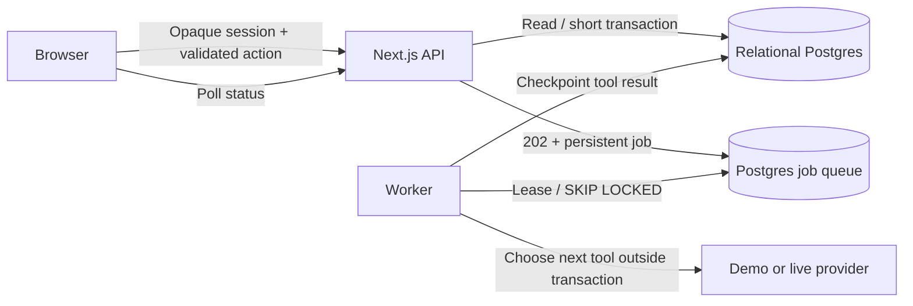

# Relational backend delivery

## What changed

The previous single-campus JSON snapshot and signed demo identity cookie were replaced with relational Postgres records, password accounts, revocable opaque sessions, validated APIs, scoped authorization and durable background agent jobs. The existing deterministic domain engine and Three.js UI remain connected to this backend.

The migration imported the existing campus workflow rather than replacing it. `leakloop_state` is retained as a legacy snapshot/rollback reference, but the updated application never reads or writes it during normal operation. New authoritative records are in the `ll_*` tables. Migrations are tracked by filename in `schema_migrations` and applied under a migration advisory lock.

## Data model and invariants

Domain records have campus, scenario-generation and entity IDs. Reset creates a new generation, so seeded IDs can be reused without overwriting old records. Accounts, sessions, command receipts and audit history survive resets.

Database foreign keys join buildings/readings/incidents/proposals/work orders/technicians/runs/tool executions. Deferred references connect an incident to its current proposal and verification. Typed columns contain state, quality, assignment, timestamps and verification results; attached JSONB payloads hold additional notes/plans. Database constraints reject invalid readings, duplicate incident work orders and conflicting active technician assignments. History records are append-only through triggers.

`lib/repository.ts` assembles the UI/domain view from relational records in a consistent read transaction. `lib/db.ts` locks the runtime revision for short mutations and stores changes atomically. Command keys are bound to the actor and a canonical payload hash. Neither the browser nor a model supplies an authoritative role or numerical decision.

The service is deliberately single-campus and still serializes campus mutations for reliable optimistic revisions. It is not presented as a high-volume ingestion platform. Operational history is retained across generations; an operator-approved retention policy is future work.

## Jobs and recovery

The HTTP process enqueues a job and returns 202. The worker claims one eligible queued/expired job with `SKIP LOCKED`, increments its delivery attempt, and establishes a lease token. Every tool result and run update is checkpointed together with job history/decision count. The provider request runs without a database lock; a changed revision causes replan before any selected tool executes.

A worker crash leaves completed checkpoints intact. After the 60-second lease expires, another worker can claim the same job and continue. A stale worker token cannot write. Jobs stop after eight decisions, two attempts per tool and three deliveries. Transient model/network failures are requeued with a delay; exhausted jobs fail visibly. Mode changes fail explicitly rather than silently substituting deterministic behavior. Reset cancels old-generation jobs.

The demo clock is persistent and lazily advanced when the UI polls. It is not a hardware scheduler. Model/API side effects outside the allowlisted local tools are absent; there are no real valves or message recipients.

## Authentication and access

Local password hashes use Node's salted scrypt; sessions use random 32-byte opaque tokens with SHA-256 hashes in Postgres. Cookies are HttpOnly, SameSite Strict, and Secure on HTTPS. Logout revokes the session. Password failures, account locks and request rate counters persist across API process restarts.

Manager actions require manager accounts. Technician mutation ownership and read scoping apply to incident evidence, work orders, tool traces and runs. Unassigned technicians receive an empty assignment screen. Operators can operate the fictional simulation; those controls cannot authorize actual spending, water interruptions, external communications or final closure. Final closure always requires a manager and fresh deterministic verification.

Strict JSON schemas and body limits precede the workflow handler. Same-origin checks protect mutations. Generic request IDs accompany errors. API keys, database credentials and local password files remain server-side. No public anonymous database policies are granted.

## Checks performed

- **33 unit/workflow/schema/access tests passed**.
- **23 backend integration checks passed**, including relational import, SQL quality/uniqueness constraints, async enqueue, active-job deduplication, stale-lease rejection, saved tool results, role rejection, durable receipts, changed-payload rejection, concurrent stale writes, append-only history, partial progress recovery, replan on changed evidence, generation/reset cancellation, exhausted delivery leases, provider-mode mismatch, hashed session storage, role revocation, expiry, login lockout and request throttling.
- The authenticated HTTP suite exercised normal human-confirmed closure, technician decline/reassignment to verified closure, and a failed repair that remained open, using actual queued jobs and the continuously running worker. It also checked login/logout, disabled demo switching, malformed/unknown fields, origin rejection, telemetry bounds, role restrictions and persisted reloads. Machine-readable counts are in `evaluation/api-results.json`.
- Browser QA: the old demo cookie led to the sign-in screen; the generated manager password signed in successfully. The role selector was replaced with the database-backed profile and sign-out control.
- Browser recovery demonstration: stopped the worker, queued an investigation, reloaded and observed it still queued at revision 59. Restarted the worker; the run completed at revision 62. The incident was already awaiting human approval, so this additional run correctly executed zero tools. Separate integration tests verify resuming after a saved tool result.
- `/api/health` returned ready / database connected / worker online, with two migrations.

Backend and HTTP suites restore the prior campus after tests; they retain historical test generations and append-only audit rows. Pause the continuous worker before `test:backend` or its `test:integration` alias to avoid competing consumers. API tests require the worker running.

## Operate locally

Run `npm run setup`, `npm run build`, then `npm run local`. The combined launcher runs the UI/API and worker. `npm run maintenance` removes expired sessions and old limiter/heartbeat rows. Local credentials are in owner-only `.local-accounts.json`; existing user records are preserved when setup is repeated.

Do not run schema migrations using a browser/anonymous database key. Back up the Postgres database with standard Postgres tooling before deploying future schema changes. Restore procedures and hosted Supabase connectivity were not tested here.

## Remaining boundaries

> Update: invitations, password recovery, session management, OIDC SSO, real device ingestion, evidence attachments, model-usage recording, health/readiness, backups with a tested restore and Docker/CI were added after this report. See `docs/OPERATIONS.md`, `docs/DEPLOYMENT.md` and `docs/API.md`. The paragraph below describes the earlier delivery.

No production deployment, SSO/MFA/password reset, public account administration API, multi-tenant authorization, hardware ingest, arbitrary evidence upload, outbound messaging, or backup/restore automation is included. High-volume load and multiple independently deployed API instances were not load-tested. The queue claim/lease logic is concurrency-tested, but the delivered runtime uses one API and one worker. Real model credentials were not provided, so live model behavior/cost remains unmeasured. The 24-fixture evaluation remains explicitly synthetic.

## Final verification summary

| Check | Result |
| --- | --- |
| TypeScript | Passed |
| Unit / workflow / schema / access tests | 33 passed |
| Database / queue / authentication integration checks | 23 passed |
| Authenticated HTTP checks | 17 passed across 44 commands and 227 requests |
| Production build | Passed |
| Migration repeat | No changes; already-applied versions skipped |
| Health | ready; database connected; worker online |

The HTTP total includes job polling and is a measured execution count, not a latency claim. Browser checks additionally verified an unassigned Maya account received the empty assignment view, then returned to a manager session. The local generated passwords are in `.local-accounts.json`; they are not included in this document.

## Persistent local recovery (November 9)

The macOS temporary directory was cleared between sessions, removing the previous runtime and local database. The app is now rebuilt in `~/Library/Application Support/LeakLoop/runtime`; its isolated PostgreSQL cluster is stored in the sibling `postgres` directory. The workspace snapshot was preserved during recovery. It contained no saved campus activity, so setup initialized a fresh fictional campus and recreated the local users using their existing saved passwords. State that existed only in the removed temporary cluster is unavailable.

Use `npm run local:macos` from the source project to prepare and run this persistent local environment. It preserves the runtime account file and existing database, installs locked dependencies when needed, migrates, seeds missing records, builds, and starts the app plus worker. It does not install a login service or provide backups. PostgreSQL remains running after Ctrl-C stops the app/worker.

The account seeder now reuses a saved local password when recreating a missing database user with the matching email. Existing database users are unchanged. This keeps the owner-only account file usable after local database recovery.

Recovery verification: persistent launcher completed from the workspace; 33 unit tests, TypeScript, production build and 17 authenticated HTTP checks passed (44 commands, 226 requests). The health endpoint reported ready/database connected/worker online. Browser re-verification was unavailable because the browser tool rejected the local URL under its URL policy.
